<div align="center">

# Homelab k3s

**Un homelab de Kubernetes híbrido ARM + x86, gestionado con GitOps.**

[](https://github.com/EA-etn/homelab-k3s/actions/workflows/validate.yml)


[English](README.md) · **Español**

</div>

## Qué es

La parte de **plataforma** de mi laboratorio: un clúster k3s en una Raspberry Pi 4 (arm64) y un
portátil (amd64), donde **Git es la única fuente de verdad**. ArgoCD vigila este repositorio y
mantiene el clúster sincronizado con él.

Las aplicaciones se construyen en otro sitio. [DevSecOps Pipeline](https://github.com/EA-etn/devsecops-pipeline)
prueba, escanea, firma y publica `demo-api` como imagen multi-arquitectura; este repo decide **qué
se ejecuta en el clúster**.



<sub><a href="https://raw.githubusercontent.com/EA-etn/homelab-k3s/main/docs/diagrams/es/01-architecture.png">🔍 Ver a tamaño completo</a></sub>

## Lo más destacado

| | |
|---|---|
| ☸️ **Clúster híbrido** | Control plane de k3s en una Raspberry Pi 4 (arm64, arranca desde SSD) + portátil como worker (amd64). La misma imagen multi-arquitectura corre en los dos |
| 🔄 **GitOps** | App of Apps: un solo `kubectl apply`, todo lo demás sale de `apps/`. Self-heal y prune activados |
| 🎯 **SLOs** | 99,5 % de disponibilidad y 99 % de peticiones en menos de 100 ms, con presupuesto de errores y alertas multi-ventana por burn rate ([docs/slo.md](docs/slo.md)) |
| 🚨 **Respuesta a incidentes** | Las alertas llegan a Telegram con el enlace al [runbook](docs/runbooks/README.md) de esa alerta. Un [dead man's switch](docs/alerting.md#dead-mans-switch) fuera de casa avisa si lo que cae es el propio sistema de alertas |
| 🧪 **Alertas con tests** | Tests unitarios con `promtool` para cada alerta de SLO y comprobaciones con `amtool` de las rutas y del mensaje de Telegram, en el CI |
| 📊 **Observabilidad** | kube-prometheus-stack con dashboards como código, 30 días de retención y tráfico sintético a través del Ingress |
| 🛠️ **Reconstruible** | Un playbook de [Ansible](docs/ansible.md) monta los nodos, k3s, los Secrets y ArgoCD; ArgoCD hace el resto desde Git (falta la reconstrucción real) |
| 🔐 **Sin secretos en claro** | Los tokens y contraseñas viven en Secrets de Kubernetes, nunca en Git en claro. El Ansible Vault que los recrea va cifrado, y tanto el CI como un hook de Git rechazan uno sin cifrar |

## Cuando algo falla

Lo que importa de una plataforma es lo que pasa en un mal día.

| Si… | Qué pasa | Evidencia |
|---|---|---|
| Muere un pod | Kubernetes lo sustituye mientras la otra réplica sigue atendiendo | ✅ Test de chaos: 300 peticiones mientras se mataba un pod, 0 fallidas |
| Cae un nodo | La réplica del otro nodo sigue atendiendo; la regla de reparto obligatoria ignora el nodo caído | Visto al suspenderse el portátil · falta el test con medición |
| El nodo vuelve | El Descheduler devuelve un pod en menos de 5 minutos: otra vez una réplica por nodo | ✅ Test con `cordon` / `uncordon` |
| Los errores o la latencia queman el presupuesto | Llega a Telegram una alerta por burn rate con su runbook | ✅ Reglas con tests en el CI · falta la prueba en vivo |
| Cae la propia máquina del monitoring | healthchecks.io deja de recibir la señal de vida y avisa desde fuera de casa | ✅ La señal llega · falta la prueba de apagado |
| Alguien cambia el clúster a mano | ArgoCD lo deja como dice Git (`selfHeal`) | Configurado |
| Se despliega una versión mala | Los pods viejos siguen atendiendo; `git revert` y ArgoCD vuelve atrás | Falta el test de chaos |

## Estructura

| Ruta | Para qué sirve |
|---|---|
| `ansible/` | Monta las máquinas y el clúster desde cero: k3s, secretos (Ansible Vault) y ArgoCD ([docs](docs/ansible.md)) |
| `bootstrap/join-worker.sh` | Alternativa manual a Ansible: une un equipo al clúster como agente k3s |
| `bootstrap/root-app.yaml` | App of Apps: la única Application que se aplica a mano |
| `apps/` | Una Application de ArgoCD por carga de trabajo. Añade un archivo aquí para desplegar algo |
| `platform/monitoring/` | Dashboards de Grafana, alertas de Prometheus y SLOs como código |
| `tests/slo/` | Tests unitarios de las reglas y alertas del SLO (`promtool`, en el CI) |
| `tests/alertmanager/` | Validación de la configuración de Alertmanager, sus rutas y el mensaje de Telegram (`amtool`, en el CI) |
| `docs/inventory.md` | Hardware, red y software instalado |
| `docs/diagrams/` | Diagramas de arquitectura como código (HTML → SVG animado, `docs/diagrams/src`) |
| `docs/slo.md` | SLOs, política de presupuesto de errores y alertas por burn rate |
| `docs/alerting.md` | Notificaciones de alertas a Telegram |
| `docs/runbooks/` | Un runbook por alerta: qué significa y qué hacer |

## Puesta en marcha

Con Ansible, desde el PC ([detalles](docs/ansible.md)):

```bash
cd ansible
ansible-playbook site.yml --ask-become-pass --ask-vault-pass --check --diff   # simulación
ansible-playbook site.yml --ask-become-pass --ask-vault-pass                  # de verdad

# Ver cómo ArgoCD crea todo lo que hay en apps/
kubectl -n argocd get applications
```

<details>
<summary>A mano, sin Ansible</summary>

```bash
# 1. Unir el portátil como worker (se ejecuta en el portátil; el token sale de la Pi)
sudo K3S_TOKEN='<token>' ./bootstrap/join-worker.sh

# 2. Entregar el clúster a Git
kubectl apply -f bootstrap/root-app.yaml
```
</details>

## Hoja de ruta

- [x] Control plane de k3s en una Raspberry Pi 4 arrancando desde SSD
- [x] ArgoCD instalado
- [x] Portátil unido como worker amd64
- [x] App of Apps: el clúster gestionado desde este repo
- [x] `demo-api` desplegada en los dos nodos (una réplica por arquitectura)
- [x] Observabilidad: Prometheus, Grafana y alertas de `demo-api`
- [x] SLOs de `demo-api`: 99,5 % de disponibilidad y 99 % en menos de 100 ms, alertas multi-ventana por burn rate con tests
- [x] Alertas a Telegram con enlace al runbook, rutas probadas en el CI
- [x] Dead man's switch: healthchecks.io avisa por Telegram si las alertas dejan de llegar (se apaga el PC, se va la luz o internet)
- [x] Descheduler: reequilibra `demo-api` entre nodos cuando un nodo vuelve (p. ej. tras suspenderse el portátil)
- [x] Cargas de prueba antiguas limpiadas y OpenBao retirado (sin uso, solo en modo dev)
- [ ] Chaos engineering: despliegue roto, quema por 5xx y apagado de un nodo (matar un pod, hecho)
- [ ] Ansible: reconstruir el homelab desde cero con un comando (código listo, falta la reconstrucción real)

## Licencia

[MIT](LICENSE)
