<div align="center">

# Homelab k3s

**A hybrid ARM + x86 Kubernetes homelab, managed with GitOps.**

[](https://github.com/EA-etn/homelab-k3s/actions/workflows/validate.yml)


**English** · [Español](README.es.md)

</div>

## What this is

The **platform** side of my lab: a k3s cluster on a Raspberry Pi 4 (arm64) and a laptop (amd64),
where **Git is the single source of truth**. ArgoCD watches this repository and keeps the
cluster in sync with it.

Applications are built elsewhere. [DevSecOps Pipeline](https://github.com/EA-etn/devsecops-pipeline)
tests, scans, signs and publishes `demo-api` as a multi-arch image; this repo decides **what runs
on the cluster**.



<sub><a href="https://raw.githubusercontent.com/EA-etn/homelab-k3s/main/docs/diagrams/en/01-architecture.png">🔍 View full size</a></sub>

## Highlights

| | |
|---|---|
| ☸️ **Hybrid cluster** | k3s control plane on a Raspberry Pi 4 (arm64, boots from SSD) + laptop worker (amd64). The same multi-arch image runs on both |
| 🔄 **GitOps** | App of Apps: one `kubectl apply`, everything else comes from `apps/`. Self-heal and prune on |
| 🎯 **SLOs** | 99.5 % availability and 99 % of requests under 100 ms, with an error budget and multi-window burn-rate alerts ([docs/slo.md](docs/slo.md)) |
| 🚨 **Incident response** | Alerts reach Telegram with a link to the [runbook](docs/runbooks/README.md) for that alert. A [dead man's switch](docs/alerting.md#dead-mans-switch) outside the house warns if alerting itself goes down |
| 🧪 **Tested alerting** | `promtool` unit tests for every SLO alert and `amtool` checks for routing and the Telegram message, in CI |
| 📊 **Observability** | kube-prometheus-stack with dashboards as code, 30-day retention and synthetic traffic through the ingress |
| 🛠️ **Rebuildable** | An [Ansible](docs/ansible.md) playbook builds the nodes, k3s, the Secrets and ArgoCD; ArgoCD does the rest from Git (real rebuild pending) |
| 🔐 **No plain-text secrets** | Tokens and passwords live in Kubernetes Secrets, never in Git in clear text. The Ansible Vault that recreates them is encrypted, and both CI and a Git hook refuse an unencrypted one |

## When something fails

The point of a platform is what happens on a bad day.

| If… | What happens | Evidence |
|---|---|---|
| A pod dies | Kubernetes replaces it while the other replica keeps serving | ✅ Chaos test: 300 requests during a pod kill, 0 failed |
| A node goes down | The replica on the other node keeps serving; the mandatory spread rule ignores the dead node | Seen when the laptop suspended · measured test pending |
| The node comes back | The Descheduler moves a pod back within 5 minutes: one replica per node again | ✅ `cordon` / `uncordon` test |
| Errors or latency burn the error budget | A burn-rate alert reaches Telegram with its runbook | ✅ Rules unit-tested in CI · live test pending |
| The monitoring host itself goes down | healthchecks.io stops receiving the heartbeat and warns from outside the house | ✅ Heartbeat arriving · power-off test pending |
| Someone changes the cluster by hand | ArgoCD puts it back as Git says (`selfHeal`) | Configured |
| A bad version is deployed | The old pods keep serving; `git revert` and ArgoCD rolls back | Chaos test pending |

## Repository layout

| Path | Purpose |
|---|---|
| `ansible/` | Builds the machines and the cluster from scratch: k3s, secrets (Ansible Vault), ArgoCD ([docs](docs/ansible.md), Spanish) |
| `bootstrap/join-worker.sh` | Manual alternative to Ansible: joins a machine to the cluster as a k3s agent |
| `bootstrap/root-app.yaml` | App of Apps: the only Application applied by hand |
| `apps/` | One ArgoCD Application per workload. Add a file here to deploy something |
| `platform/monitoring/` | Grafana dashboards, Prometheus alerts and SLOs as code |
| `tests/slo/` | Unit tests for the SLO rules and alerts (`promtool`, run in CI) |
| `tests/alertmanager/` | Alertmanager config, routing and Telegram message checks (`amtool`, run in CI) |
| `docs/inventory.md` | Hardware, network and installed software |
| `docs/diagrams/` | Architecture diagrams as code (HTML → animated SVG, `docs/diagrams/src`) |
| `docs/slo.md` | SLOs, error budget policy and burn-rate alerts (Spanish) |
| `docs/alerting.md` | Alert notifications to Telegram (Spanish) |
| `docs/runbooks/` | One runbook per alert: what it means and what to do (Spanish) |

## Getting started

With Ansible, from the PC ([details](docs/ansible.md)):

```bash
cd ansible
ansible-playbook site.yml --ask-become-pass --ask-vault-pass --check --diff   # dry run
ansible-playbook site.yml --ask-become-pass --ask-vault-pass                  # for real

# Watch ArgoCD create everything in apps/
kubectl -n argocd get applications
```

<details>
<summary>By hand, without Ansible</summary>

```bash
# 1. Join the laptop as a worker (run on the laptop; the token comes from the Pi)
sudo K3S_TOKEN='<token>' ./bootstrap/join-worker.sh

# 2. Hand the cluster over to Git
kubectl apply -f bootstrap/root-app.yaml
```
</details>

## Roadmap

- [x] k3s control plane on a Raspberry Pi 4 booting from SSD
- [x] ArgoCD and OpenBao (secrets) installed
- [x] Laptop joined as an amd64 worker
- [x] App of Apps: the cluster managed from this repo
- [x] `demo-api` deployed across both nodes (one replica per architecture)
- [x] Observability: Prometheus, Grafana and alerts for `demo-api`
- [x] SLOs for `demo-api`: 99.5 % availability and 99 % under 100 ms, multi-window burn-rate alerts with unit tests
- [x] Alerts to Telegram with a runbook link, routing tested in CI
- [x] Dead man's switch: healthchecks.io notifies on Telegram if alerts stop arriving (the PC goes down, power or internet is lost)
- [x] Descheduler: rebalances `demo-api` across nodes when a node comes back (e.g. after the laptop suspends)
- [ ] Chaos engineering: bad deploy, 5xx burn, node power-off (pod kill done)
- [ ] Ansible: rebuild the homelab from scratch with one command (code ready, real rebuild pending)
- [ ] Clean up legacy test workloads and decide what to do with OpenBao (unused today)

## License

[MIT](LICENSE)
