<div align="center">

# Homelab k3s

**A hybrid home + cloud, ARM + x86 Kubernetes homelab, managed with GitOps.**

[](https://github.com/EA-etn/homelab-k3s/actions/workflows/validate.yml)


**English** · [Español](README.es.md)

</div>

## What this is

The **platform** side of my lab: a k3s cluster with its control plane on a Raspberry Pi 4 at home
(arm64) and its worker on a cloud VPS (amd64), joined by an encrypted WireGuard network. **Git is the
single source of truth**. ArgoCD watches this repository and keeps the
cluster in sync with it.

Applications are built elsewhere. [DevSecOps Pipeline](https://github.com/EA-etn/devsecops-pipeline)
tests, scans, signs and publishes `demo-api` as a multi-arch image; this repo decides **what runs
on the cluster**.



<sub><a href="https://raw.githubusercontent.com/EA-etn/homelab-k3s/main/docs/diagrams/en/02-hybrid.png">🔍 View full size</a></sub>

The nodes talk only through the VPN (`wg0`): k3s, Flannel and kubectl never cross the internet in
clear text. The hub lives on a second VPS that stays out of the cluster, so breaking the cluster on
purpose never takes the network down ([docs/wireguard.md](docs/wireguard.md), Spanish).

<details>
<summary>Before: everything at home (<code>v1.0-casa</code>)</summary>



The laptop slept and moved around: when it went, half the app and all the monitoring went with it
(chaos experiments 4a and 4b). That is why the worker moved to a VPS. Release:
[`v1.0-casa`](https://github.com/EA-etn/homelab-k3s/releases/tag/v1.0-casa).
</details>

## Highlights

| | |
|---|---|
| ☸️ **Hybrid cluster** | k3s control plane on a Raspberry Pi 4 at home (arm64, boots from SSD) + worker on a cloud VPS (amd64). The same multi-arch image runs on both |
| 🔒 **Private network** | WireGuard between home and cloud, managed by Ansible: each machine generates its own private key, which never leaves it. `ufw` on the VPS, and Grafana answers only the VPN (`403` from the internet) |
| 🔄 **GitOps** | App of Apps: one `kubectl apply`, everything else comes from `apps/`. Self-heal and prune on |
| 🎯 **SLOs** | 99.5 % availability and 99 % of requests under 100 ms, with an error budget and multi-window burn-rate alerts ([docs/slo.md](docs/slo.md)) |
| 🚨 **Incident response** | Alerts reach Telegram with a link to the [runbook](docs/runbooks/README.md) for that alert. A [dead man's switch](docs/alerting.md#dead-mans-switch) outside the house warns if alerting itself goes down |
| 🧪 **Tested alerting** | `promtool` unit tests for every SLO alert and `amtool` checks for routing and the Telegram message, in CI |
| 📊 **Observability** | kube-prometheus-stack with dashboards as code, 30-day retention and synthetic traffic through the ingress |
| 🛠️ **Rebuildable** | An [Ansible](docs/ansible.md) playbook builds the nodes, k3s, the Secrets and ArgoCD; ArgoCD does the rest from Git (verified: **destroyed and rebuilt from scratch in ~12 minutes** with `reset.yml` + `site.yml`; a second run reports `changed=0`). The move from home to hybrid was itself a rebuild |
| 🔐 **No plain-text secrets** | Tokens and passwords live in Kubernetes Secrets, never in Git in clear text. The Ansible Vault that recreates them is encrypted, and both CI and a Git hook refuse an unencrypted one |

## When something fails

The point of a platform is what happens on a bad day. Every experiment, with its hypothesis and findings: [docs/chaos.md](docs/chaos.md) (Spanish).

These experiments ran on `v1.0-casa` (Pi + laptop). Repeating the node experiments on the hybrid cluster is next.

| If… | What happens | Evidence |
|---|---|---|
| A pod dies | Kubernetes replaces it while the other replica keeps serving | ✅ Chaos test: 300 requests during a pod kill, 0 failed |
| A node goes down | The replica on the other node keeps serving; the mandatory spread rule ignores the dead node | ✅ Chaos test: powering off the Pi showed that ingress and DNS only ran there (0 % served, no alert). After the fix: `TargetDown` on Telegram in 10 min and the app partly served; the rest needs 3 control-plane nodes |
| The node comes back | The Descheduler moves a pod back within 5 minutes: one replica per node again | ✅ `cordon` / `uncordon` test |
| Errors or latency burn the error budget | A burn-rate alert reaches Telegram with its runbook | ✅ Chaos test: 20 % of requests failing → critical alert in ~21 min, while pods stayed `Running` |
| The monitoring host itself goes down | healthchecks.io stops receiving the heartbeat and warns from outside the house | ✅ Chaos test: PC powered off → healthchecks.io alerted on Telegram and email |
| The whole cluster is lost | `reset.yml` + `site.yml` rebuild it: Ansible creates k3s, Secrets and ArgoCD; ArgoCD brings back everything else from Git | ✅ Destroyed and rebuilt: k3s + ArgoCD in 4 min 26 s, every app healthy in ~12 min |
| Someone changes the cluster by hand | ArgoCD puts it back as Git says (`selfHeal`) | Configured |
| A bad version is deployed | The old pods keep serving; `git revert` and ArgoCD rolls back | ✅ Chaos test: image that does not exist → no user impact, alert in ~10 min, fixed in 3 min with a revert |

## Repository layout

| Path | Purpose |
|---|---|
| `ansible/` | Builds the machines and the cluster from scratch: k3s, secrets (Ansible Vault), ArgoCD ([docs](docs/ansible.md), Spanish) |
| `bootstrap/join-worker.sh` | Manual alternative to Ansible: joins a machine to the cluster as a k3s agent |
| `bootstrap/root-app.yaml` | App of Apps: the only Application applied by hand |
| `apps/` | One ArgoCD Application per workload. Add a file here to deploy something |
| `platform/monitoring/` | Grafana dashboards, Prometheus alerts and SLOs as code |
| `tests/slo/` | Unit tests for the SLO rules and alerts (`promtool`, run in CI) |
| `tests/alertmanager/` | Alertmanager config, routing and Telegram message checks (`amtool`, run in CI) |
| `docs/inventory.md` | Hardware, network and installed software |
| `docs/wireguard.md` | The VPN, the VPS firewall and the move to the hybrid cluster (Spanish) |
| `docs/diagrams/` | Architecture diagrams as code (HTML → animated SVG, `docs/diagrams/src`) |
| `docs/slo.md` | SLOs, error budget policy and burn-rate alerts (Spanish) |
| `docs/alerting.md` | Alert notifications to Telegram (Spanish) |
| `docs/runbooks/` | One runbook per alert: what it means and what to do (Spanish) |

## Getting started

With Ansible, from the laptop ([details](docs/ansible.md)):

```bash
cd ansible
ansible-playbook site.yml --ask-become-pass --ask-vault-pass --check --diff   # dry run
ansible-playbook site.yml --ask-become-pass --ask-vault-pass                  # for real

# Watch ArgoCD create everything in apps/
kubectl -n argocd get applications
```

<details>
<summary>By hand, without Ansible (legacy: home LAN, before the VPN)</summary>

```bash
# 1. Join the laptop as a worker (run on the laptop; the token comes from the Pi)
sudo K3S_TOKEN='<token>' ./bootstrap/join-worker.sh

# 2. Hand the cluster over to Git
kubectl apply -f bootstrap/root-app.yaml
```
</details>

## License

[MIT](LICENSE)
